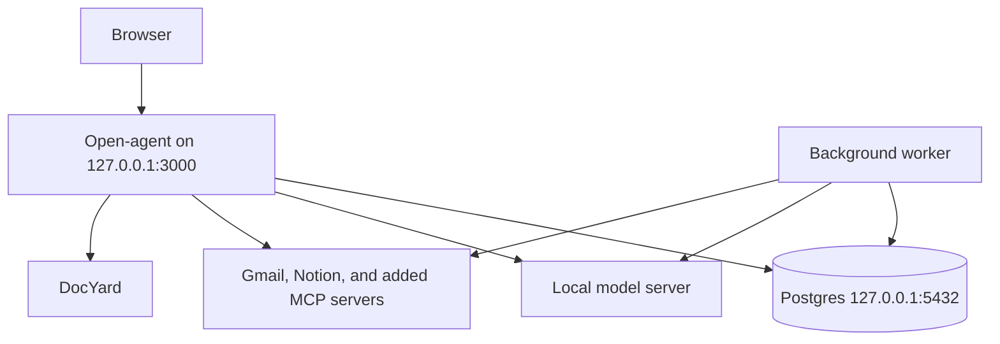
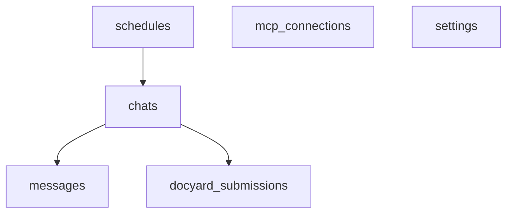
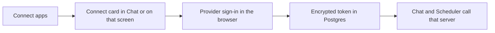
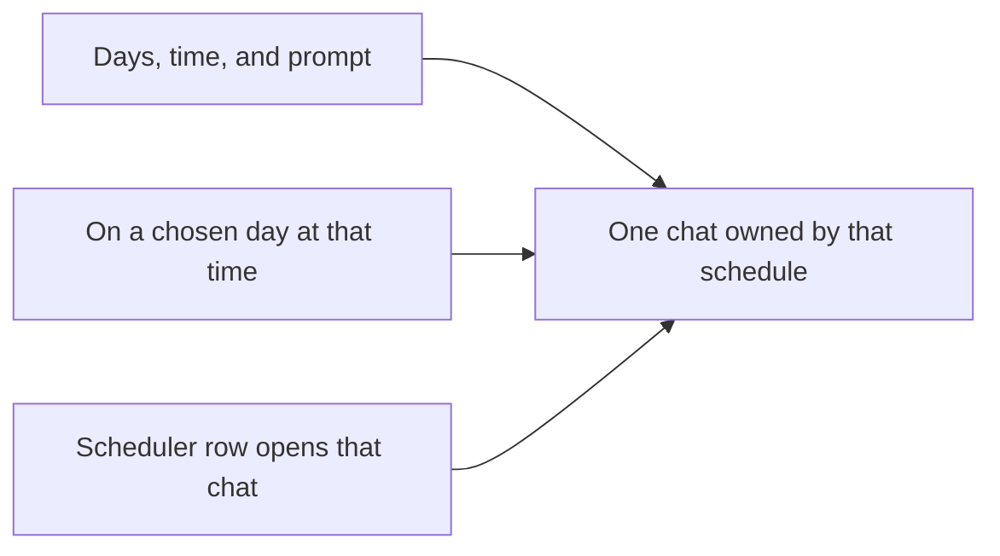

# Architecture

Updated **2026-11-21**. This is the target architecture from the requirements
discussion. It is not what the running code does today.
[SPEC.md](SPEC.md) owns the product requirements.
The running app uses its own Postgres database. SQLite is not part of this app.

Anyone clones the GitHub repository, installs its packages, and runs it. The
app is not shipped as an installer. One clone serves the person using it, on
loopback.

## What runs

- The browser talks only to the Next.js app at `127.0.0.1:3000`. Chat is the
  screen that opens. The list shows the 10 most recently updated chats. Archive
  lists the older chats and opens them. Archive does not delete a chat.
- The web app and one background worker share one Postgres database. The worker
  holds a single lease so a second worker does not run the same job.
- The person starts Postgres themselves at `127.0.0.1:5432`. Open-agent uses its
  own database on that server. DocYard may use the same Postgres server and must
  use a different database. The apps do not read each other's tables.
- The local model is a separate program on the same machine, such as Ollama.
  Settings store its address and model name. Open-agent does not download or
  host the weights. The model must be able to call tools. It never receives MCP
  tokens.
- Gmail, Notion, and any MCP the person adds are outside the app. Chat and the
  worker call them only after that connection is signed in.
- DocYard is called only when the person asks, in that chat, to share a summary
  and then confirms the summary text.

## Database

Postgres at `127.0.0.1:5432` is the filing cabinet. Open-agent has its own
database there. Six drawers hold the product data.

1. **chats** is one row per conversation: title, created time, and updated time.
   The home screen reads the 10 rows with the newest update. Archive is every
   chat after those 10. There is no archive flag.
2. **messages** are the lines inside one chat: who spoke, the text, and the time.
   A normal chat and a schedule chat use this table. When a schedule runs, the
   prompt and the assistant reply are new rows here.
3. **schedules** is one row per schedule: name, time of day, weekdays, prompt,
   status, and the id of the one chat it owns. The Scheduler screen opens that
   chat from this id.
4. **schedule_runs** is one row per day a schedule was due. It records the day
   and whether that day is waiting, running, done, missed, skipped, or failed.
   It does not copy the answer. The same schedule and day cannot be inserted
   twice. Run adds the prompt to the schedule's chat. Skip leaves that chat
   unchanged.
5. **mcp_connections** is one row per app. Gmail, Notion, and an app added with
   Add MCP are the same kind of row: name, server address, and state (`needs
   auth`, `connected`, or `disconnected`). The token is encrypted in the row.
6. **docyard_submissions** is one row per confirmed share: the chat id, the id
   DocYard returns, and the last known result. The summary text stays in the
   chat messages.
7. **settings** stores the display name, timezone, model address, and model name.
   Schedule days and times use that timezone.

LangGraph keeps its own checkpoint tables in this same database so a chat can
be resumed. **leases** stop a second worker from running the same job.
**operations** record a write that already finished so an approval is not
applied twice.

Tokens are not returned to the browser, written into prompts, or sent to the
model. Memory and skills stay Markdown files. Stocks, built-in Google accounts,
and CreativeNest reply tables are not part of this design. Existing to-do rows
from an old database are not read. This revision does not authorize deleting
them. Vector search is later.

## A chat turn

1. The browser posts the message to the chat API. The server checks the host,
   origin, size, and shape, then claims that conversation.
2. LangGraph reloads the checkpoint. The prompt includes the current time, the
   display name, the timezone, `USER.md`, `MEMORY.md`, and short skill
   descriptions.
3. The tool list is the built-in set plus the tools of signed-in connections the
   question refers to. Built-in tools cover the clock, public web search,
   memory, skills, creating a schedule, and sharing a chat summary.
4. The local model answers or calls a tool. Read-only tools run immediately.
   A tool that changes data stops and shows the exact action. The person
   approves or rejects it in that chat. Each write keeps a stable operation id
   so a replay does not repeat a completed action.
5. Text and tool activity stream back to the browser. A stopped or failed run
   can be resumed. The full transcript stays saved.

Public web reads still reject private and loopback addresses. Web pages, MCP
results, and skill text are untrusted data. There is no shell tool.

## Connect apps

Third-party apps connect through MCP. The first screen offers Gmail and Notion.
**Add MCP** lets the person enter a name and a server address, then use the same
sign-in path.

- Sign-in uses MCP OAuth with PKCE and the server's published authorization
  requirements. Where the server allows it, the app registers itself during
  sign-in so the person does not create a cloud project first. If a server
  requires a pre-registered client id, Connect apps asks for that id once.
- The person does not paste an access token into Chat.
- A connection can be listed before it is signed in. Chat and the Scheduler may
  call it only after the state is connected.
- A later authentication failure shows the Connect card again.
- Disconnect deletes the local token. It does not have to revoke the provider's
  consent.
- Open-agent does not keep a copy of the mailbox or the Notion workspace.

## Scheduler

A schedule is a prompt that runs in one chat. There are no separate reminder,
Gmail-check, or Notion-check job types. The prompt covers those.

- A schedule can be created in two ways, and both save the same row.
  - **From Chat.** The person describes it in a conversation. The assistant uses
    a tool and shows the days, time, and prompt. The row is saved only after
    the person approves it. The conversation where they asked stays a normal
    chat.
  - **Directly.** On the Scheduler screen the person enters the days, time, and
    prompt. That saves the row immediately.
- Saving the row creates the one chat that schedule owns. Later runs append to
  that chat, not to the conversation where the person asked for the schedule.
- On a chosen weekday, at the stored time, the worker sends that prompt into
  that chat and the assistant replies there, using the local model and any
  signed-in MCP the prompt needs.
- The Scheduler row opens that chat.
- If the computer was off or the app was not running, that day is not run late
  by itself. It appears under Needs attention. Run sends the prompt into the
  same chat. Skip leaves the chat unchanged.
- A scheduled reply may read and answer by itself. If the reply would change
  data, that step waits for approval in the chat.
- The person can edit, pause, resume, run now, or cancel. Pausing does not
  collect missed runs. Past runs stay in the history.
- The Scheduler does not call DocYard and does not sign in to an MCP. If the
  prompt needs an app that is not signed in, the reply says so.

The worker still checks about every ten seconds while it holds the lease.
Timezone comes from Settings.

## DocYard

DocYard receives a summary of the current chat only.

1. The person asks in that chat to share a summary.
2. The assistant drafts it from that conversation. Other chats, Scheduler
   history, mail, and credentials are not attached.
3. The person confirms that text.
4. The server-side connector submits the confirmed summary and stores the
   submission id on that chat.
5. DocYard previews it and the person chooses the output there. Submission does
   not create a file and does not approve one.
6. Open-agent checks known submissions once on a full load and when the person
   refreshes. It does not poll. If DocYard is down, the last result stays and
   the refresh is shown as failed.

## Limits

- One person per clone. No shared login.
- Jobs run only while this machine and the worker are running.
- An unclear external write is not silently retried as a new operation.
- Stocks, Inbox, Calendar, the built-in Google client, Groq, xAI, and
  CreativeNest are not part of this architecture.
- Vector search, saved-content full-text search, and macOS auto-start remain
  later work.
